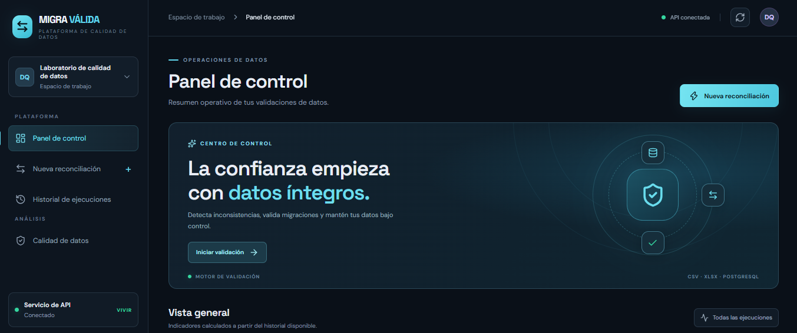
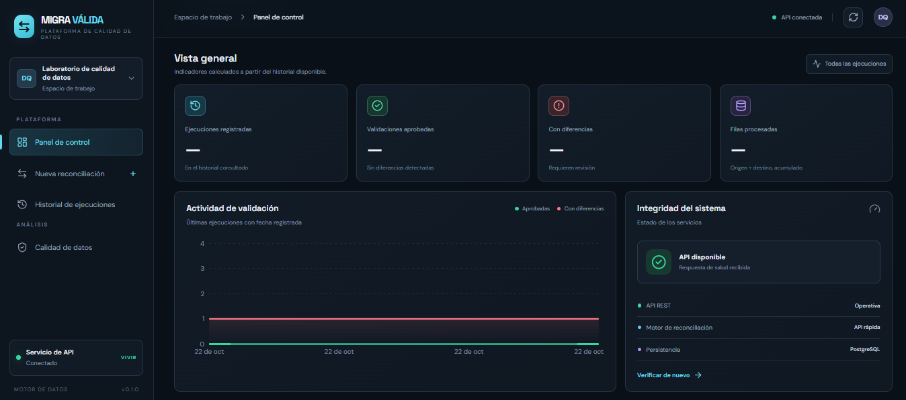
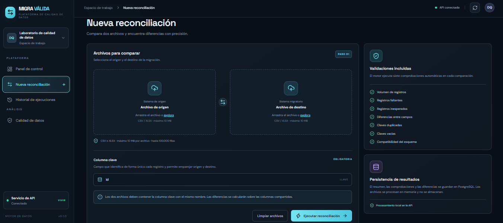
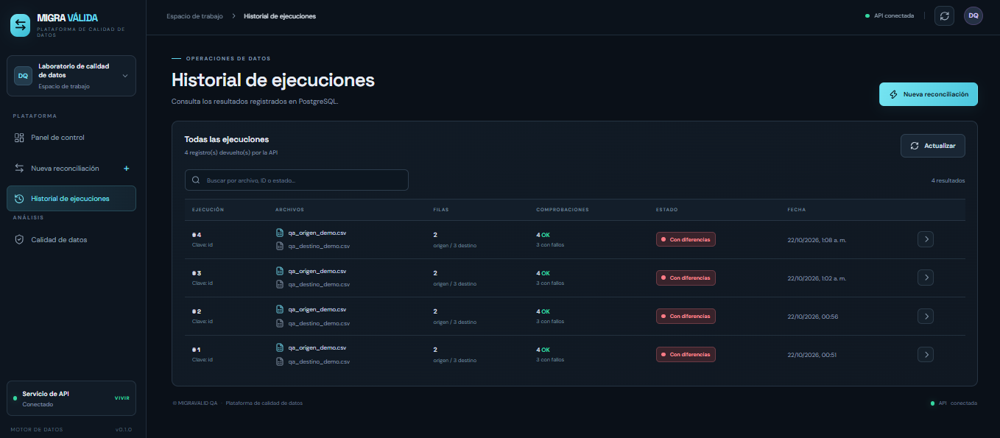
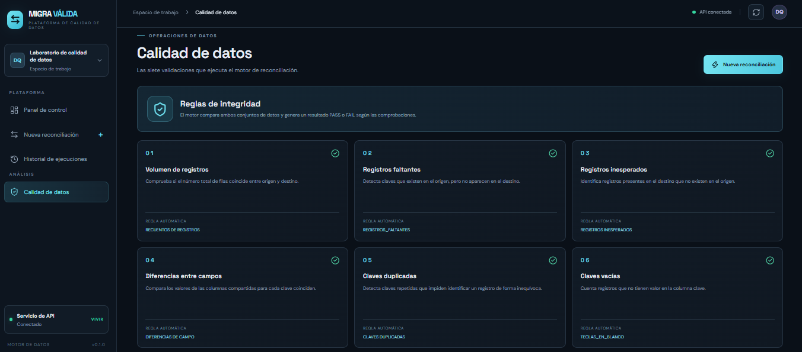

# Data Migration QA

A personal portfolio project for validating, comparing, and reconciling data between source and target systems through a web application, an API, and automated tests.

## Links

- **Web application:** https://data-migration-qa.vercel.app/
- **API:** https://data-migration-qa-api.onrender.com/
- **API documentation:** https://data-migration-qa-api.onrender.com/docs
- **API health check:** https://data-migration-qa-api.onrender.com/api/v1/health
- **Source code:** https://github.com/Jonathanjimenez123/data-migration-qa

## Objective

Demonstrate practical skills in data quality assurance (Data QA), migration validation, API development, and automated testing.

## Features

- Data comparison between source and target systems.
- Detection of missing and unexpected records.
- Identification of differences between records.
- Access to results and execution history.
- API endpoints for available functionality.
- Automated tests with pytest.
- Sample data for validation scenarios.

## Technologies

- **Frontend:** React and Vite.
- **Backend:** Python and FastAPI.
- **Testing:** pytest.
- **Database:** PostgreSQL.
- **Deployment:** Vercel and Render.
- **Version control:** Git and GitHub.

## Screenshots

### 1. Dashboard



### 2. Dashboard details



### 3. New reconciliation



### 4. Execution history



### 5. Data quality



## Running the tests

If the virtual environment and dependencies are already installed, run:

```powershell
Set-Location "C:\data-migration-qa"
$env:PYTHONPATH="$PWD\apps\api"
& ".\apps\api\.venv\Scripts\python.exe" -m pytest -q apps\api\tests
```

An earlier development run reported 15 passing tests. Run the command above to verify the current status.

## Technical documentation

- [Architecture](docs/ARCHITECTURE.md)
- [Testing](docs/TESTING.md)

## Security

- Use fictional data in public examples.
- Do not publish passwords, tokens, secret keys, `.env` files, or connection strings.
- Configure credentials through environment variables.

## About the project

A personal learning and portfolio project intended to demonstrate practical knowledge of data QA, test automation, Python, web development, and API development. It is not presented as paid professional work experience.